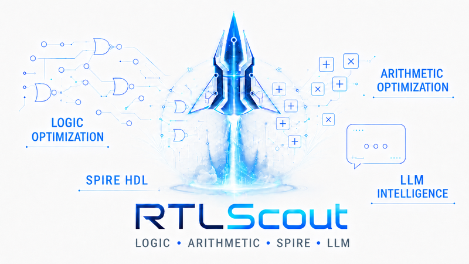
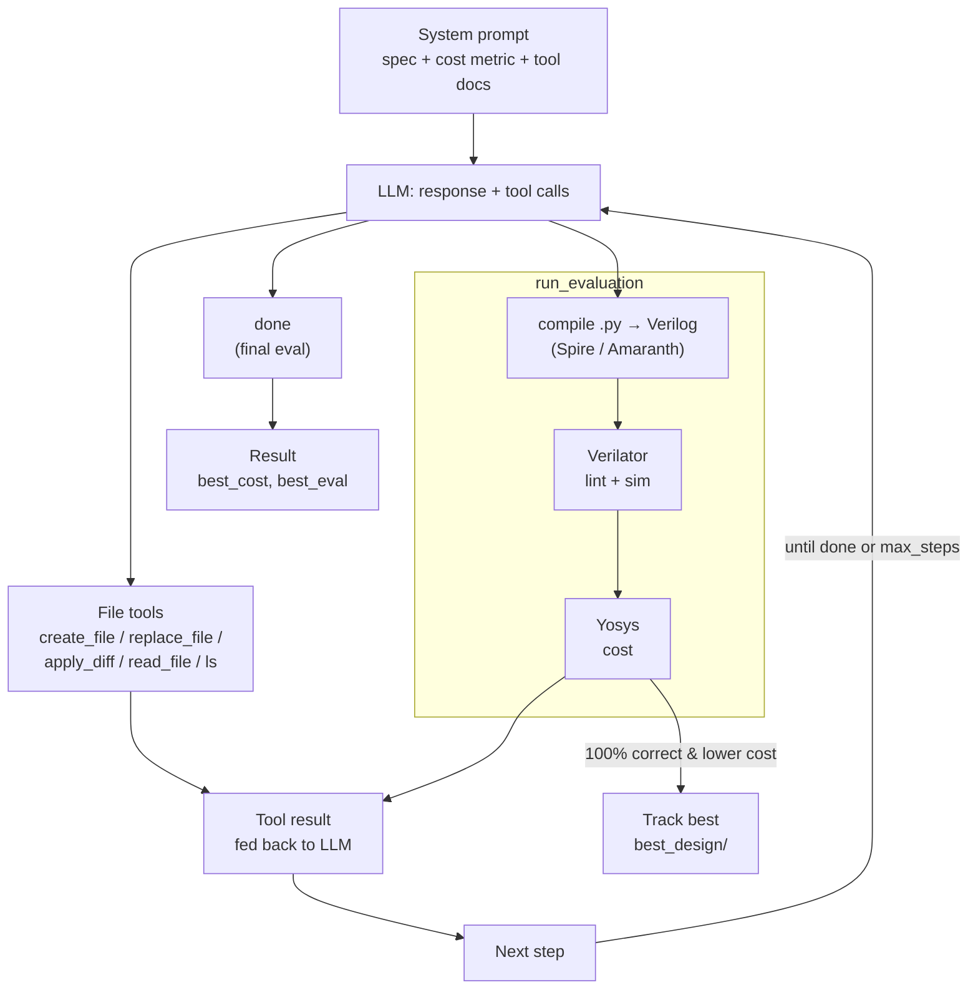
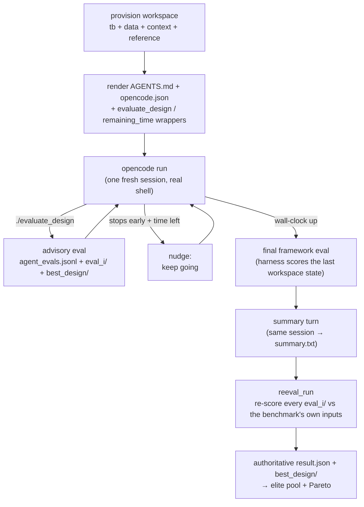

<div align="center">
  
</div>

<br>

<p align="center">
  <a href="https://github.com/huawei-csl/rtlscout/actions/workflows/pytest.yml"></a>
  <a href="LICENSE"></a>
  <a href="https://arxiv.org/abs/2606.06530"></a>
  <a href="https://github.com/orgs/huawei-csl/packages/container/package/rtlscout"></a>
  <a href="https://vscode.dev/redirect?url=vscode%3A%2F%2Fms-vscode-remote.remote-containers%2FcloneInVolume%3Furl%3Dhttps%3A%2F%2Fgithub.com%2Fhuawei-csl%2Frtlscout"></a>
</p>

# RTL Scout

An RTL design agent powered by selectable LLM backends (DeepInfra, Anthropic, OpenRouter, or a self-hosted OpenAI-compatible server) with tool use. The agent iteratively creates and optimizes Verilog/SystemVerilog, [Spire HDL](https://github.com/huawei-csl/spire-hdl) or Amaranth designs, targeting **correctness first, then minimal cost** under a configurable cost metric. The agent can run as the built-in in-process loop or as an external OpenCode agent in a sandboxed, per-run container.

## What RTL Scout does

- Generates and optimizes RTL from a specification or a starting design.
- Runs correctness checking with Verilator-based testbenches.
- Evaluates cost with Yosys/ABC, OpenROAD, or AIG-based metrics.
- Supports single-agent runs and multi-run elite-pool optimization.
- Supports Verilog, Spire HDL, and Amaranth design flows.
- Provides scripts to extract best designs, Pareto fronts, and plots.

## Quick start

This smoke test runs an offline fake model, so it needs no API key, provider, or long benchmark run.

```bash
git clone --recurse-submodules https://github.com/huawei-csl/rtlscout.git
cd rtlscout
bash .devcontainer/pull_image.sh           # pull the prebuilt EDA image (~3 GB)
bash .devcontainer/start_container.sh      # install deps + drop into the container shell

# inside the container shell:

# smoke test, no API required
python -m rtlscout.run_benchmark --benchmark simple_adder --model fake:simple_adder_pass
python -m rtlscout.run_eval benchmarks/fpmul_f16/context/starting_point.py --benchmark benchmarks/fpmul_f16 --language spirehdl --cost-metric area --target-delay 500

# copy .env
cp .env.template .env
```

**Expected result for rtlscout.run_benchmark:** the run finishes **without an API key** and writes results under `runs/` (look for a `Best: PASS` line near the end of the output).

**Expected result for rtlscout.run_eval:** it compiles and evaluates the bundled FP16 reference (also **without an API key**, since it only evaluates an existing design, no LLM), printing an `=== Evaluation Result ===` block with `Correctness: PASS` and the design's `area`.

Next, add real API keys to `.env` and pick a workflow from [Choosing an entry point](#choosing-an-entry-point); for the VS Code flow or build-from-source options, see [Installation](#installation-details).

## Requirements

- **Docker**: the EDA toolchain (OpenROAD, Yosys, Verilator, OpenSTA, sv2v) and the Python environment ship as a prebuilt image, so nothing else needs to be installed on the host.
- **Git** with submodule support: the `spire-hdl` submodule is required.
- **~3 GB** of free disk for the prebuilt slim image (~54 GB if you build the full image from source).
- *(optional)* **VS Code** with the Dev Containers extension, for the devcontainer workflow.
- *(for real runs only)* an **LLM provider API key** (DeepInfra, Anthropic, or OpenRouter) or a **local OpenAI-compatible server** (vLLM, Ollama, llama.cpp, LM Studio). Not needed for the quick start above.

## Installation Details

Pick the VS Code devcontainer or a manual Docker setup; both use the same prebuilt EDA image.

### VS Code Dev Container

1. Clone this repo with submodules:
   ```bash
   git clone --recurse-submodules https://github.com/huawei-csl/rtlscout.git
   ```
2. Open the `rtlscout` folder in VS Code.
3. When prompted, click **"Reopen in Container"** (or run the command *Dev Containers: Reopen in Container*).
4. Once the container is up, set the VS Code Python interpreter to `~/pyenv_eda/bin/python` (*Python: Select Interpreter* → enter that path).

The Dev Container extension will **pull the prebuilt image** (the default) and start the environment, or build it from source instead (see *Docker image* below). Edit `.env` with your API keys once inside:
```bash
cp .env.template .env && code .env
```

### Manual Docker setup

```bash
# 1. Clone this repo with submodules (--recurse-submodules checks out spire-hdl for you)
git clone --recurse-submodules https://github.com/huawei-csl/rtlscout.git
cd rtlscout

# 2. Edit .env with your API keys (ANTHROPIC_API_KEY, OPENROUTER_API_KEY, etc.)
cp .env.template .env
vi .env

# 3. Get the Docker image: pull the prebuilt slim image (fast; recommended)
bash .devcontainer/pull_image.sh
#    (or build from source: bash .devcontainer/build_image.sh; see "Docker image" below)

# 4. Start the container (mounts repo, installs packages, drops into shell)
bash .devcontainer/start_container.sh
```

### Docker image options

The base EDA image (OpenROAD, Yosys, Verilator, OpenSTA, sv2v, …) is large. The easiest path is to **pull the prebuilt slim image**; building from source is fully supported as an alternative.

- **Prebuilt pull** (default, recommended): `bash .devcontainer/pull_image.sh`. Pulls `ghcr.io/huawei-csl/rtlscout:slim` (~3 GB) and tags it `rtlscout:latest` (the tag `start_container.sh` and the devcontainer expect). By hand: `docker pull ghcr.io/huawei-csl/rtlscout:slim && docker tag ghcr.io/huawei-csl/rtlscout:slim rtlscout:latest`.
- **Slim self-build**: `BUILD_SLIM=1 bash .devcontainer/build_image.sh`. Builds the same ~3 GB image from source: same toolchain, but drops the OpenROAD build tree and the PDK data the flow never reads (uses `.devcontainer/base/Dockerfile.slim`; shares the full build's compile cache).
- **Full self-build**: `bash .devcontainer/build_image.sh`. Builds everything from source (~1–2 h the first time; ~54 GB image).

The VS Code devcontainer pulls by default; to self-build instead, edit `initializeCommand` in `.devcontainer/devcontainer.json`.

Verilator compilation uses `ccache` by default (`OBJCACHE=ccache`). The cache lives in
`/tmp/ccache`, outside the per-evaluation `obj_dir`, so repeated evaluations in the
same container can reuse compiled C++ objects. Set `CCACHE_DIR` to a mounted directory
to retain the cache across container recreation. Use `ccache --show-stats` to inspect
reuse, or `CCACHE_DISABLE=1` to bypass caching.

### Install as a Python package

RTL Scout is also an installable package (`rtlscout`), so another project can use it without working inside this checkout. It is installed from git by URL:

```bash
pip install "rtlscout @ git+https://github.com/huawei-csl/rtlscout"
```

This installs the head of the default branch. pip records the exact commit in the package metadata (`direct_url.json`; `pip freeze` prints it as `rtlscout @ git+https://github.com/huawei-csl/rtlscout@<sha>`), so an installation stays traceable; to pin one, append `@<commit>` to the URL.

The EDA tools are not Python packages: install it inside the container image (or wherever Yosys, Verilator, OpenROAD and sv2v are on `PATH`). Every command-line tool is a module of the package and runs the same way from a checkout and from an installation, `python -m rtlscout.<name>`; the repository root holds no scripts:

| Module | Purpose |
|--------|---------|
| `rtlscout.run_eval` | evaluate one design: correctness and cost |
| `rtlscout.run_benchmark` | one agent run on one benchmark |
| `rtlscout.run_multirun` | a campaign of agent runs sharing an elite pool |
| `rtlscout.run_pipeline` | the two-phase pipeline ending in a Pareto front |
| `rtlscout.run_sweep`, `rtlscout.run_model` | many models or benchmarks in one go |
| `rtlscout.batch_eval`, `rtlscout.extract_pareto` | re-evaluate a folder of designs; the Pareto-optimal designs of runs |
| `rtlscout.containers` | the OpenCode backend's containers |
| `rtlscout.add_benchmark` | generate a benchmark from the spire-hdl arithmetic generators |
| `rtlscout.tools.extract_best_designs`, `rtlscout.tools.extract_sweep_pareto`, `rtlscout.tools.measure_db_compositions` | post-processing of run directories |
| `rtlscout.plots.plot_results`, `rtlscout.plots.plot_multirun`, `rtlscout.plots.plot_pareto_paper`, `rtlscout.plots.plot_area_delay`, `rtlscout.plots.plot_area_delay_with_ref`, `rtlscout.plots.visualize_db_run` | plots |

```bash
# from any directory, no checkout needed: a packaged smoke benchmark and an offline fake model
python -m rtlscout.run_benchmark --benchmark simple_adder --model fake:simple_adder_pass

# your own benchmark tree
RTLSCOUT_BENCHMARKS=/path/to/benchmarks python -m rtlscout.run_benchmark --benchmark my_design --model <provider>:<model>
```

Outside a checkout the package finds its surroundings through these variables (a checkout needs none of them; see [`rtlscout/paths.py`](rtlscout/paths.py)):

| Variable | Meaning | Default |
|----------|---------|---------|
| `RTLSCOUT_HOME` | workspace root: holds `.env`, `benchmarks/`, `deps/` | the checkout the package runs from, else the current directory |
| `RTLSCOUT_ENV_FILE` | `.env` with the provider API keys | `<workspace root>/.env` |
| `RTLSCOUT_BENCHMARKS` | benchmark trees, separated by `:` | `<workspace root>/benchmarks` (plus `internal/benchmarks` if present) |
| `RTLSCOUT_CACHE_DIR` | derived files such as the merged ASAP7 liberty | `<checkout>/.cache`, else `~/.cache/rtlscout` |
| `RTLSCOUT_SPIRE_HDL_DIR` | spire-hdl source tree | `<workspace root>/deps/spire-hdl` |

Requests to OpenRouter models (`openrouter:<vendor>/<model>`) take three more, all unset by default:

| Variable | Meaning | Default |
|----------|---------|---------|
| `RTLSCOUT_REASONING_EFFORT` | `low`, `medium`, `high`, `max` or `off`: the model's reasoning effort, passed through to the provider (which levels a model offers is the provider's business) | the provider's default |
| `RTLSCOUT_OPENROUTER_PROVIDERS` | upstream providers to use, e.g. `z-ai`, comma-separated in order of preference, no fallback to others | OpenRouter's routing |
| `RTLSCOUT_OPENROUTER_MAX_TOKENS` | cap on one completion, reasoning included | the provider's cap |

Each run's `result.json` tallies the providers that served it and the finish reasons (`llm_providers`, `finish_reasons`).

A self-hosted model (`local:<model name as the server knows it>`) is reached through two more: `LOCAL_BASE_URL`, the server's `/v1` endpoint (required, e.g. `http://localhost:8000/v1` for vLLM or `http://localhost:11434/v1` for Ollama), and `LOCAL_API_KEY` (optional; most local servers accept any value). The server must implement the OpenAI chat-completions API with tool calls.

Spire HDL runs (`--language spirehdl` with an agent) quote the spire-hdl documentation and examples in their prompts. Those are part of the spire-hdl repository, not of its wheel, so outside a checkout point `RTLSCOUT_SPIRE_HDL_DIR` at a clone of [spire-hdl](https://github.com/huawei-csl/spire-hdl) at the installed version. Evaluating an existing Spire design (`run_eval`) and all Verilog and Amaranth flows need only the installed packages. The OpenCode backend's orchestrated mode mounts the workspace root into its containers and therefore needs a checkout.

## Benchmarks

Each benchmark is a directory under `benchmarks/`, and directories can be nested in subfolders for grouping, e.g. the RTLRewriter cases under `benchmarks/dr_rtl/` (referenced as `--benchmark dr_rtl/<case>`). A few of the bundled benchmarks:

- `simple_adder`, `simple_mux`, `alu8`: small logic warm-ups
- `seq_detector`, `fifo_sync4`: sequential designs (FSM, FIFO)
- `fpmul_f16`, `fpadd_f16`: floating-point (Spire)
- `mult8`, `mult4`: arithmetic units

When a benchmark ships a starting-point design under `context/` (e.g. `fpmul_f16`'s `starting_point.py`), run it with the `--language` that matches that file: `spirehdl` for a `.py` Spire source, `verilog` for a `.v`, `amaranth` for an Amaranth design.

Browse `benchmarks/` for the full set; to add your own, see **[README_add_benchmarks.md](README_add_benchmarks.md)**.

## Choosing an entry point

| Goal | Command | Use when |
|------|---------|----------|
| Evaluate an existing design | `rtlscout.run_eval` | You already have Verilog/Spire/Amaranth and want correctness + cost |
| Run one agent | `rtlscout.run_benchmark` | Debugging or trying one benchmark/model |
| Run many agents with an elite pool | `rtlscout.run_multirun` | Optimizing one objective more seriously |
| Build an area-delay Pareto front | `rtlscout.run_pipeline` | Best results, but token-heavy and slow |
| Reproduce RTLRewriter paper tables | [Bundled RTLRewriter results](#bundled-rtlrewriter-results) | The 14 general (non-FP) cases; cell & transistor count tables |
| Reproduce FP paper experiments | [`README_fpmul.md`](README_fpmul.md) | Specialized `fpmul_f16` / `fpadd_f16` pipeline |

Each is detailed in [Running benchmarks](#running-benchmarks) below. Every script is also a module of the installed package (`python -m rtlscout.run_eval`, …); see [Install as a Python package](#install-as-a-python-package).

## Agent Flow

RTLScout runs one optimization agent per run, selected by **`--agent-backend react|opencode`**
(the two subsections below). Both iterate on the design and report an *advisory* score as they go.

Optionally, the harness then re-evaluates the designs, so a tampered or noisy number can't reach the
elite pool. This runs automatically for **OpenCode** (its shell makes its own score untrustworthy)
and is off by default for **react** (no shell, so its number is already trustworthy).

### Python ReAct Backend (`--agent-backend react`, default)

A **pure-Python loop**: a capability-confined agent calls tools from a limited set on its `workspace/`
subdir, with **no shell/CLI tool** available. It is bounded by `--max-steps` (there is no wall-clock
limit). Because it can't reach the scorer, its in-process number is already trustworthy and feeds the
pool directly.



**Strategy:** build a simple correct design first, evaluate it, then iteratively optimize the cost
metric, reverting on any correctness regression, until `done` or `max_steps`.

### OpenCode Backend (`--agent-backend opencode`)

The external [OpenCode](https://opencode.ai) agent runs with a
**real shell**, once per run in its own sandbox. Because a shell can tamper its own copy of the
scorer/inputs, its advisory number is **never trusted** — the harness always re-derives the
recorded score (the `reeval` step below) against the benchmark's own inputs.

**Sandboxing — `--mode`** (OpenCode only — the react agent has no shell and always runs
in-process, so `--mode orchestrated` with `--agent-backend react` is rejected):

- `single-container` (default) — agent + judge run in the current container. Convenience / dev;
  lower assurance.
- `orchestrated` — a fresh `docker run --rm` container per agent run **and** per scored
  candidate → full isolation and the adversarial-agent integrity guarantee. Containers are
  managed purely by **label** (never by image), so a co-running devcontainer on
  `rtlscout:latest` is never touched.



Budget: `--wall-clock-min` sets the hard per-run time budget — the agent is terminated when it's
up, and nudged to keep going if it stops early. The wrap-up is framework-driven (react parity):
after the process ends the harness itself scores the final workspace state, resumes the session
for `summary.txt`, and exports the full session (parent + task-tool children) — so a run killed
mid-step loses nothing measurable. Optional: `--design-db-skills` adds the
[design-DB skills layer](#skill-based-flow---agent-backend-opencode---design-db-skills). Build
the agent image once with
`docker build -f .devcontainer/Dockerfile.opencode -t rtlscout-opencode:latest .`; clean up
orchestrated containers with `python -m rtlscout.containers cleanup`.

See **[README_orchestration.md](README_orchestration.md)** for the full sandboxing + integrity
model: assurance by mode, the advisory/authoritative split, OpenCode permissions/launch quirks,
and label-based cleanup.


## Design DB — an agent-filled library of verified subcircuits

Spire ships a **design DB** (`spire.design_db`, see
[README_design_db.md](https://github.com/huawei-csl/spire-hdl/blob/main/docs/README_design_db.md)): a
content-addressed store of *slots* (subcircuits with a golden reference), where every stored
implementation passed the slot's **frozen verification** (CEC or a golden-simulated trace tb) on
insert, and builds *select* deterministically via `@from_design_db(objective=..., metric=...)`.
RTLScout is the DB's filler and its agentic layer.

### Skill-based flow (`--agent-backend opencode --design-db-skills`)

Any standard OpenCode run (`rtlscout.run_benchmark` / `rtlscout.run_multirun --agent-backend opencode`,
both sandbox modes) gains the design-DB skills layer with the **`--design-db-skills`** flag —
one flag, no extra command; without it the run is a plain OpenCode run (nothing DB-related is
provisioned, mentioned, or forwarded). The DB *capability* is spire's and exists regardless
(`spire db` auto-creates `./design_db` on first use); this flag adds the guidance and the
handover. It includes:

- **Skills** at `.opencode/skills/` (copied from [rtlscout/skills/](rtlscout/skills/)) —
  `design-db-inspect` (slots/designs/Pareto + how to judge results), `design-db-insert` /
  `design-db-eval` (spire-first: submit/check `cand.py` candidates through the gate),
  `design-db-dv-prep` (verification prep for sequential slots), `design-db-dispatch`
  (delegation protocol), `design-db-score` (on-demand technology PPA, measure-and-store or
  `--dry-run`). Actions are plain `spire db …` commands wherever spire has them.
- **Subagents** in the rendered `opencode.json` — `rtl-subcircuit` and `rtl-dv-prep`
  (`mode: subagent`, hidden, **task tool denied** = structural recursion cap), delegated to via
  the primary agent's task tool; results are read from the DB (`spire db show --pareto`), never
  from subagent claims.
- **DB handover**: `rtlscout.run_benchmark` defaults to a per-run workspace `./design_db`;
  `rtlscout.run_multirun` defaults to a **campaign DB** at `<runs-root>/design_db` shared by all runs
  of the campaign — run N starts with everything runs 1..N-1 verified, and an elite seed's
  `@from_design_db` decorators re-splice against the populated library instead of an empty
  one. `--design-db-path PATH` (or `$SPIREHDL_DB_PATH`, e.g. for a persistent cross-campaign
  library) overrides; the resolved root is forwarded into orchestrated agent containers with a
  writable mount. Concurrent fills are safe (the per-slot index is derived from
  atomically-admitted design dirs; manifest writes are fcntl-locked), so a shared DB +
  `--max-concurrent > 1` and parallel slot dispatch are supported.

```bash
# one run, private workspace DB (./design_db inside the run's workspace)
python -m rtlscout.run_benchmark --benchmark sat_mac4 --model openrouter:z-ai/glm-5.2 \
    --agent-backend opencode --language spirehdl --design-db-skills --wall-clock-min 20

# campaign: all runs share <runs-root>/design_db — later runs start from the filled library
python -m rtlscout.run_multirun --benchmark sat_mac4 --model openrouter:z-ai/glm-5.2 \
    --agent-backend opencode --language spirehdl --design-db-skills \
    --total-runs 10 --max-concurrent 4 --wall-clock-min 20

# persistent library across campaigns: point both at the same root
python -m rtlscout.run_multirun ... --design-db-skills --design-db-path /data/my_subcircuit_lib
```

Whether the DB actually gets used is up to the benchmark: the skills are progressive-disclosure
(the agent's context carries only the one-line listing until it opens one), so on a benchmark
that doesn't invite decomposition the layer costs a few lines and stays idle. `--language
spirehdl` is what makes it productive — `@from_design_db` slots register and splice only from
spire designs.

Trust model unchanged: agents propose, spire's gate disposes — inserts only via
`spire db insert` (verify → dedup → metric-stamp → admit), frozen verifications are immutable,
and technology PPA enters only through the measure-and-store `db-score` (never hand-typed).

**Visualizing a run:**

```bash
python -m rtlscout.tools.measure_db_compositions <run_dir>   # optional: measure full-circuit splice combos
python -m rtlscout.plots.visualize_db_run <run_dir>          # -> <run_dir>/visualization.html
```

One self-contained HTML report (inline SVG, no dependencies): per-slot Pareto fronts
(area × AIG depth) colored by subagent source tag, the main agent's selections, admission
timelines with running best, agent activity lanes — and, after `rtlscout.tools.measure_db_compositions`,
the **full-circuit composition space**: every splice combination of the per-slot fronts
recompiled with forced (`pin=`-style) selections and measured for real (`--all-designs` widens
to all admitted designs). An example report (sat_mac4_par, GLM-5.2) is checked in at
[artifacts/db_run_visualizations/sat_mac4_par_glm-5.2_visualization.html](artifacts/db_run_visualizations/sat_mac4_par_glm-5.2_visualization.html).

### Non-agentic tools (campaign filler & scorer)

| Command | What it does |
|---|---|
| `python -m rtlscout.containers fill-db --slot <key> --model <provider:model>` | Campaign filler: slot → ephemeral benchmark → `run_multirun(reeval=True)` → every passing candidate through Spire's gate (the slot's own golden is seeded first as the baseline/floor). |
| `python -m rtlscout.containers db-score [--slot K --design ID --technology asap7 --dry-run]` | Measures per-technology PPA on stored designs and annotates the DB (enables `metric="asap7"` selection); `--design` scopes to one design, `--dry-run` measures without writing. Backs the `design-db-score` skill. |

The decorator's generate-on-miss hook is `rtlscout.design_db_fill.rtlscout_fill`
(`@from_design_db(fill=rtlscout_fill)`; model via `$RTLSCOUT_FILL_MODEL` or
`make_rtlscout_fill(model=...)` — never a silent default). Trust model in one line: **agents
propose; spire's gate disposes** — inserts only ever pass through `spire db insert`
(verify → dedup → metric-stamp → admit), recursion is structurally denied (the subagents have
no task tool), and reports/selections are computed from the DB, never taken from agent claims.


## Running benchmarks

> Every command here drives an LLM provider, so set your API token in `.env` first (`DEEPINFRA_API_KEY`, `ANTHROPIC_API_KEY`, `OPENROUTER_API_KEY`, …); see [Installation](#installation-details). The `--model` argument always uses **`provider:model`** syntax; providers are `deepinfra`, `anthropic`, `openrouter`, `local` (a self-hosted OpenAI-compatible server at `LOCAL_BASE_URL`) and `fake` for offline testing.

The examples use `fpmul_f16`, but any directory under `benchmarks/` works; swap the benchmark, model, and cost metric for yours.

### Single run — `rtlscout.run_benchmark`

One agent works a single benchmark for a step budget and reports the best design it finds.

```bash
python -m rtlscout.run_benchmark \
    --benchmark fpmul_f16 \
    --model openrouter:qwen/qwen3.7-max \
    --cost-metric transistors \
    --language spirehdl
```

#### Spire optimization-guidance flags

These flags (all **Spire-only**; Verilog/Amaranth runs ignore them) opt the agent into extra synthesis-aware guidance in its system prompt. They're off by default; turn them on for later-stage polishing once a correct structural design exists. The same flags are accepted by `rtlscout.run_multirun` and (via the phase machinery) `rtlscout.run_pipeline`.

- `--abc-optimize`: adds **`@abc_optimized`** guidance: the agent may wrap combinational logic with the decorator that runs an ABC logic-synthesis script over it.
- `--arith-autoconfig`: adds **`replace_arithmetic_ops()` / `@arithmetic_optimized`** guidance: the agent may reconfigure how `*`/`+`/etc. are implemented (multiplier/adder architecture) instead of leaving them to the default operator mapping.
- `--fsm-optimize`: adds **FSM / state-encoding** guidance (the `State` API plus the `optimized_fsm` / `optimized_encoding` wrappers), letting the agent explore alternative state encodings for sequential designs.
- `--dont-touch-main-arith`: the inverse guard: tells the agent **not** to modify the core `MultiplierConfig` / `AdderConfig`, useful when you want to sweep everything *except* the main arithmetic blocks.
- `--flowy-optimize`: adds `@mockturtle_optimized` (Mockturtle) guidance (the Spire API decorator is `@flowy_optimized`); note Mockturtle is not installed in the default image, so this is only useful in a Mockturtle-enabled environment.

### Multirun campaign — `rtlscout.run_multirun`

Many agents run in parallel sharing an **elite pool**: some start fresh (exploration), the rest are seeded from the best designs found so far (exploitation). This is the core optimizer and usually beats single runs on a given objective. See **[README_multirun.md](README_multirun.md)** for the full set of knobs: elite-pool sizing, the fresh schedule, seeding formats, and per-campaign plotting. With the OpenCode backend, `--design-db-skills` additionally gives all runs a shared **campaign design DB** (verified subcircuits accumulate across runs — see [the skill-based flow](#skill-based-flow---agent-backend-opencode---design-db-skills)).

```bash
python -m rtlscout.run_multirun \
    --benchmark fpmul_f16 \
    --model openrouter:qwen/qwen3.7-max \
    --total-runs 10 --max-concurrent 4 --max-steps 30 \
    --cost-metric area --language spirehdl
```

### Pipeline — `rtlscout.run_pipeline`

Chains two phases of multirun campaigns and combines everything into a single Pareto front:

- **Phase 1**: structural exploration, one campaign per cost metric, no synthesis decorators.
- **Phase 2**: synthesis-aware polish: each campaign is *seeded* from the matching Phase-1 elite pool and run as pure exploitation. For Spire the agent additionally gets `@arithmetic_optimized` and `@abc_optimized`.
- **Pareto**: the Pareto-optimal designs across all campaigns, written to `pareto_fronts/<benchmark>/`.

Running a campaign for **both** `area` and `delay` (the default `--metrics area,delay`) and combining them produces the area-vs-delay front, the **area + speed** workflow that a single `--cost-metric` run can't obtain.

```bash
python -m rtlscout.run_pipeline \
    --benchmark fpmul_f16 \
    --model openrouter:qwen/qwen3.7-max \
    --metrics area,delay \
    --total-runs 8 --max-concurrent 4 --max-steps 20 \
    --language spirehdl
```

- `--metrics area` runs a single objective; `--no-phase2` stops after Phase 1.
- `--fsm-optimize` adds FSM / state-encoding guidance (Spire); `--dont-touch-main-arith` freezes configurable multiplier/adder configs (`MultiplierConfig` / `AdderConfig`).
- `--target-delay` (ps) sets the synthesis timing constraint for PPA metrics: lower pushes toward faster logic at the cost of area (typical range 200–2000).
- `--dry-run` prints the exact `rtlscout.run_multirun` and `rtlscout.extract_pareto` commands the pipeline would run, so you can drive the phases by hand. On completion it also prints the `rtlscout.plots.plot_pareto_paper` command to chart the front.

> **Note:** This is the *general* (less specialized) workflow. The FP-specialized **4-phase** pipeline (arithmetic-architecture sweep + high-effort Mockturtle refinement) is documented separately in **[README_fpmul.md](README_fpmul.md)**.

See the [Usage](#usage) section for more command examples.

## Architecture

```
core/
├── prompts.py       # System prompt builders (Verilog + Spire + Amaranth)
├── correctness.py   # Verilator lint + simulation
├── cost.py          # Pluggable cost metrics (transistors, PPA delay/area/power)
├── evaluation.py    # Combines correctness + cost
├── agent.py         # Tool-use agent (7 tools)
├── llm_client.py    # LLM backends (DeepInfra, Anthropic, OpenRouter, local OpenAI-compatible servers)
├── benchmarks.py    # Benchmark loading
└── runner.py        # Orchestration (model x benchmark)

benchmarks/          # benchmark suite (one dir per benchmark)
rtlscout.run_benchmark     # CLI: single benchmark + model
rtlscout.run_model         # CLI: all benchmarks for one model
rtlscout.run_sweep         # CLI: multiple models x benchmarks
rtlscout.run_multirun      # CLI: async elite-pool multi-run optimisation
rtlscout.run_pipeline      # CLI: Phases 1-2 pipeline (multirun campaigns + Pareto)
rtlscout.run_eval          # CLI: re-evaluate a design file
rtlscout.plots.plot_results      # CLI: plotting at any level
```

### ReAct backend tools

| Tool | Description |
|------|-------------|
| `create_file` | Create a new file |
| `replace_file` | Overwrite an existing file |
| `apply_diff` | Apply a unified diff patch |
| `ls` | List files in working directory |
| `read_file` | Read file contents |
| `run_evaluation` | Run correctness (Verilator) + cost evaluation |
| `done` | Signal completion |

### Evaluation

The `run_evaluation` tool returns both:
- **Correctness**: Verilator lint + simulation against a self-checking testbench (pass/fail per TB_CASE)
- **Cost**: Pluggable metric (see below)

The agent is instructed to get 100% correctness first with a simple design, then iterate to reduce cost. The **best result** is the lowest cost among fully correct designs. The best design's workspace is automatically saved to `best_design/` for later use.

### Equivalence checking (CEC)

Simulation only checks the testbench vectors. For a stronger guarantee, a combinational equivalence check (CEC) verifies that the produced design is *logically* equivalent to a golden reference. It synthesizes both designs to BLIF with Yosys and compares them with `yosys-abc`'s `cec`. When the designs are **not** equivalent, the evaluation is gated to FAIL even if simulation passed.

CEC is **on by default**. The reference comes from a `golden_reference` key in the benchmark's `metadata.json` (a `.v`/`.sv` used directly, or a `.py` compiled to Verilog); benchmarks without that key simply skip the check. Pass `--skip-cec` on any `run_*` entry point to disable it.

```bash
# Re-evaluate the bundled FP16 reference; CEC runs against its golden_reference
python -m rtlscout.run_eval benchmarks/fpmul_f16/context/design.v \
    --benchmark benchmarks/fpmul_f16 --language verilog
# ... prints "CEC: EQUIVALENT" in the result block (~2.5s for this design)

# Disable the check
python -m rtlscout.run_eval ... --skip-cec
```

CEC runs only when correctness already passed, and is fast for the bundled combinational designs. For example, `fpmul_f16` (16-bit, ~1.9k cells) checks in a couple of seconds.

## Cost metrics

The cost metric is configurable via `--cost-metric`. All metrics follow the same interface (`CostMetric` ABC) and the metric name propagates automatically into system prompts, JSON output, and plot labels.

| Metric | `--cost-metric` | Tool chain | Description |
|--------|-----------------|------------|-------------|
| Transistors | `transistors` (default) | Yosys + ABC | Estimated transistor count via `stat -tech cmos` |
| Yosys cells | `yosys_cells` | Yosys | Cell count after `synth; clean -purge; stat` (technology-independent) |
| Yosys wires | `yosys_wires` | Yosys | Wire count after `synth; clean -purge; stat` (technology-independent) |
| Yosys transistors | `yosys_transistors` | Yosys | Transistor count from the same `synth; clean -purge; stat` pipeline (hierarchy-correct; matches `yosys_cells`/`yosys_wires` on multi-module designs) |
| Delay | `delay` | Yosys + OpenROAD STA | Critical-path delay (ps) |
| Area | `area` | Yosys + OpenROAD STA | Design area (um^2) |
| Power | `power` | Yosys + OpenROAD STA | Total power (W) |
| Area × delay | `area_delay_product` | Yosys + OpenROAD STA | Area (um^2) × critical-path delay (ps): the classic area-delay product, the metric of the public leaderboard |
| Area × delay, fast | `area_delay_product_fast` | Yosys + ABC | The same product from a direct yosys → BLIF → ABC mapping onto the asap7 library: no OpenROAD, no netlist simulation, no target-delay constraint; the quick path for large designs |
| Area × delay, sky130 | `sky130_adp`, `sky130_adp_v2` | Yosys + ABC | Area × delay against the sky130 high-density library through the same direct ABC path; `_v2` cleans alias buffers before mapping |
| Cycles | `cycles` | simulation only | The workload's cycle count as reported by the testbench (`TB_CYCLES total=<C>`); no synthesis |
| Runtime | `runtime` | Yosys + OpenROAD STA | cycles × achieved critical-path delay: the workload's execution time |
| Area × runtime | `area_runtime_product` | Yosys + OpenROAD STA | area × cycles × delay: inverse throughput per area for the fixed workload (not the classic area × delay) |
| Accesses | `accesses` | simulation only | Memory reads + writes reported by the testbench (`TB_READS`, `TB_WRITES`), a data-movement proxy; no synthesis |
| Accesses × area × runtime | `access_area_runtime_product` | Yosys + OpenROAD STA | accesses^k × area × runtime; `k` is `--energy-exp` (default 1), k = 0 reduces it to `area_runtime_product` |
| Energy | `energy` | Yosys + OpenROAD + netlist simulation | Measured energy (fJ) of the workload: total power at the achieved clock from the VCD-annotated gate-level simulation × runtime |
| Energy × area × runtime | `energy_area_runtime_product` | Yosys + OpenROAD + netlist simulation | energy^k × area × runtime with `k` = `--energy-exp` (default 1) |
| AIG count | `aig_count` | Yosys + aigverse | Post-optimization AIG AND-node count (`num_gates` = `len(aig.gates())`, i.e. AND nodes only, excluding the constant and primary-input nodes), combinational designs only |
| AIG depth | `aig_depth` | Yosys + aigverse | Post-optimization AIG logic depth (`DepthAig.num_levels()`), combinational designs only |

**Transistors** runs a fast Yosys + ABC flow (`proc; opt; fsm; memory; opt; techmap; opt; abc -fast; opt`) and reads the estimated transistor count from `stat -tech cmos`. The **yosys_cells / yosys_wires / yosys_transistors** variants are Yosys-only (technology-independent): they skip ABC and instead run `synth; clean -purge; stat`. The `clean -purge` step drops public-alias buffers that `opt_clean` preserves for debuggability, giving counts that more faithfully reflect the netlist. **Delay/area/power** and the products built on them use the `rtlscout.tech_eval` package, which synthesizes against a standard cell library and runs OpenROAD static timing analysis; the library is `--technology asap7` by default (`nangate45` and `freepdk45` are the alternatives). **aig_count / aig_depth** measure the And-Inverter Graph after aigverse AIG optimization (yosys `aigmap` → aigverse); combinational designs only.

For PPA metrics, the `--target-delay` flag (in ps) controls the synthesis timing constraint. Lower values push for faster designs at the expense of area/power.

The cycle-aware metrics (`cycles`, `runtime`, `area_runtime_product`, `accesses`, `access_area_runtime_product`, `energy`, `energy_area_runtime_product`) need a testbench that prints `TB_CYCLES total=<C>` (and `TB_READS total=<R>` / `TB_WRITES total=<W>` for the access metrics) when the workload is done; benchmarks without those lines fail cleanly under them. The two `energy` metrics simulate the gate-level netlist with activity capture, so they cannot run with `--skip-netlist-sim`. `--energy-exp k` sets the exponent of the first factor in `access_area_runtime_product` and `energy_area_runtime_product`; it is an exponent rather than a weight because scaling one factor of a product never changes which design is optimal.

## Usage

Beyond the three entry points above, these commands cover cost metrics, languages and providers, running across many models, and post-processing of results.

### Using different cost metrics

```bash
# Optimize for area (PPA)
python -m rtlscout.run_benchmark \
  --model openrouter:qwen/qwen3.7-max \
  --benchmark fifo_sync4 \
  --cost-metric area \
  --target-delay 500

# Optimize for delay (PPA)
python -m rtlscout.run_benchmark \
  --model openrouter:qwen/qwen3.7-max \
  --benchmark alu8 \
  --cost-metric delay \
  --target-delay 300

# Optimize for power (PPA)
python -m rtlscout.run_benchmark \
  --model openrouter:qwen/qwen3.7-max \
  --benchmark seq_detector \
  --cost-metric power \
  --target-delay 500
```

### Using Spire

The `--language spirehdl` flag switches the agent from writing Verilog directly to writing Python scripts using the Spire embedded DSL. The framework runs the `.py` file; the script writes Verilog directly via `m.to_verilog_file("design.v")`, and the resulting file is evaluated as usual.

The agent's working directory is on the Python path, so the agent can split logic across multiple `.py` files and use plain imports (e.g. `from helper import build_adder`). The main entry point passed to `run_evaluation` (e.g. `design.py`) is the only file that gets executed by the framework.

```bash
python -m rtlscout.run_benchmark \
  --model openrouter:qwen/qwen3.7-max \
  --benchmark mult8 \
  --language spirehdl \
  --max-steps 65 \
  --cost-metric delay
```

### Using different LLM providers

```bash
# OpenRouter
python -m rtlscout.run_benchmark \
  --benchmark alu8 \
  --model openrouter:qwen/qwen3.7-max

# Anthropic
python -m rtlscout.run_benchmark \
  --benchmark alu8 \
  --model anthropic:claude-sonnet-4-5-20250929

# DeepInfra
python -m rtlscout.run_benchmark \
  --benchmark alu8 \
  --model deepinfra:meta-llama/Llama-3.3-70B-Instruct-Turbo

# A model served locally (vLLM, Ollama, llama.cpp, LM Studio): LOCAL_BASE_URL in .env points at the server
python -m rtlscout.run_benchmark \
  --benchmark alu8 \
  --model local:Qwen/Qwen3-32B

# Mixed providers in a sweep
python -m rtlscout.run_sweep \
  --models anthropic:claude-sonnet-4-5-20250929 deepinfra:meta-llama/Llama-3.3-70B-Instruct-Turbo
```

### Run all benchmarks for a model

```bash
python -m rtlscout.run_model --model openrouter:qwen/qwen3.7-max
```

Run a subset of benchmarks:

```bash
python -m rtlscout.run_model \
  --model openrouter:qwen/qwen3.7-max \
  --benchmarks simple_adder simple_mux alu8
```

### Sweep across models and benchmarks

```bash
# Sweep with default transistor cost
python -m rtlscout.run_sweep \
  --models deepinfra:meta-llama/Llama-3.3-70B-Instruct-Turbo deepinfra:Qwen/Qwen2.5-72B-Instruct \
  --benchmarks simple_adder simple_mux

# Sweep with area cost
python -m rtlscout.run_sweep \
  --models deepinfra:meta-llama/Llama-3.3-70B-Instruct-Turbo deepinfra:Qwen/Qwen2.5-72B-Instruct \
  --cost-metric area \
  --target-delay 500 \
  --max-steps 20
```

### Saving evaluation snapshots

A workspace snapshot is saved **by default** before each evaluation: the workspace files, the evaluation result, and a summary. Snapshots are stored as `eval_1/`, `eval_2/`, etc. alongside the run's `best_design/` and `result.json`. Each `eval_{i}/` contains:
- `workspace/`: copy of the design files at that step
- `result.json`: full evaluation result (correctness, cost, pass rate)
- `summary.txt`: human-readable evaluation summary

Pass `--dont-save-workspaces` to skip the snapshots and save disk (note: `rtlscout.extract_pareto` / `rtlscout.tools.extract_best_designs` rely on them):

```bash
python -m rtlscout.run_benchmark \
  --model openrouter:qwen/qwen3.7-max \
  --benchmark mult8 \
  --language spirehdl \
  --max-steps 65 \
  --cost-metric delay \
  --dont-save-workspaces
```

### Re-evaluate a design

Use `rtlscout.run_eval` to re-run the evaluation pipeline on an existing design file (e.g. from a previous run). Useful for testing with updated testbenches or different cost metrics.

By default the eval runs in a *throwaway sandbox copy* of the design's folder (deleted afterwards), so pointing it at a benchmark's `context/` never leaves artifacts behind. A pre-existing `.spire_cache` is copied in (warm reads) but never written back. Pass `--in-place` to run directly in the source folder instead — that's how you keep `design.v`/build artifacts for inspection or warm a `.spire_cache` next to the design; `--workdir DIR` (orthogonal) selects a different source folder than the design file's parent.

```bash
# Basic: evaluate a Spire design (language auto-detected from .py extension)
python -m rtlscout.run_eval runs/fpmul_f16/claude-opus-4-6/20260311_140923/best_design/workspace/design.py

# Explicit language + cost metric
python -m rtlscout.run_eval runs/.../workspace/design.py --cost-metric delay --target-delay 500

# Use testbench from the original benchmark directory (e.g. after regenerating test vectors)
python -m rtlscout.run_eval runs/.../best_design/workspace/design.py --benchmark benchmarks/fpmul_f16

# Output as JSON
python -m rtlscout.run_eval runs/.../workspace/design.py --json
```

Flags:
- `--language`: `verilog`, `spirehdl`, or `amaranth` (default: auto-detect from extension)
- `--cost-metric`: any registered metric (e.g. `transistors`, `yosys_cells`, `yosys_wires`, `yosys_transistors`, `delay`, `area`, `power`, `area_delay_product`, `area_runtime_product`, `energy`, `aig_count`, `aig_depth`; see [Cost metrics](#cost-metrics))
- `--target-delay`: synthesis timing constraint in ps (default: 500)
- `--technology`: standard cell library for the PPA metrics: `asap7` (default), `nangate45` or `freepdk45`
- `--energy-exp`: exponent `k` of `access_area_runtime_product` and `energy_area_runtime_product` (default: 1.0)
- `--top-module`: override top module name (default: auto-detect from `design.v`)
- `--workdir`: override workspace directory (default: parent of design file)
- `--benchmark`: copy `tb.sv` and `vectors.dat` from this benchmark directory into the workspace before evaluation
- `--json`: print result as JSON instead of human-readable summary

### Extract best designs

Extract the top N passing designs from any run directory (multirun or single benchmark), sorted by a chosen metric.

```bash
# Top 5 by cost (default)
python -m rtlscout.tools.extract_best_designs runs/multirun_20260316_143944 -n 5 -o best_5/

# Top 3 sorted by delay
python -m rtlscout.tools.extract_best_designs runs/mult8 -n 3 --sort-by delay -o best_delay/
```

Flags:
- `-n` / `--top`: number of designs to extract (default: 5)
- `-o` / `--output`: output directory (default: `<run_dir>/best_extracted`)
- `--sort-by`: metric to sort by: `cost` (default), `area`, `delay`, `power`

Output includes the design files and a `best_designs.json` manifest linking each file back to its original eval.

### Extract Pareto-optimal designs

Extract designs on the area-vs-delay Pareto front. A design is Pareto-optimal if no other design is strictly better in both area and delay.

```bash
python -m rtlscout.extract_pareto runs/multirun_20260316_143944 -o pareto_front/
```

Flags:
- `-o` / `--output`: output directory (default: `<run_dir>/pareto_front`)

Output includes the design files and a `pareto_front.json` manifest with full PPA metrics.

### Plot results

The plotting script auto-detects the level from the JSON structure. Axis labels and titles adapt to whichever cost metric was used.

```bash
# Benchmark level (step-by-step cost + pass rate)
python -m rtlscout.plots.plot_results --input runs/<benchmark>/<model>/<timestamp>/result.json

# Model level (pass/fail + cost per benchmark)
python -m rtlscout.plots.plot_results --input runs/<dir>/summary_<model>.json

# Sweep level (pass rate heatmap + cost comparison across models)
python -m rtlscout.plots.plot_results --input runs/<dir>/all_results.json
```

Use `--no-accuracy` to hide the pass-rate secondary axis in benchmark plots. Pass rate is instead encoded in bar color (green = 100% correct, yellow = partial, orange = failed), with cross markers and percentage labels for non-passing evaluations:

```bash
python -m rtlscout.plots.plot_results --input runs/.../result.json --no-accuracy
```

Override output directory:

```bash
python -m rtlscout.plots.plot_results --input runs/sweep/all_results.json --output-dir my_plots/
```

`rtlscout.plots.plot_results` covers benchmark/model/sweep plots. For the **area-vs-delay Pareto front** produced by `rtlscout.run_pipeline` (or a multirun campaign), use `rtlscout.plots.plot_pareto_paper` instead; this is the command `rtlscout.run_pipeline --dry-run` prints on completion. It takes the multirun run directory (containing `multirun_summary.json`):

```bash
python -m rtlscout.plots.plot_pareto_paper runs/multirun_20260316_143944
```


### Visualize a design-DB skills run

For `--design-db-skills` runs, one self-contained HTML report per run (inline SVG, hover
tooltips, no dependencies):

```bash
python -m rtlscout.tools.measure_db_compositions runs/<bench>/<model>/<ts>   # optional: full-circuit splice combos
python -m rtlscout.plots.visualize_db_run runs/<bench>/<model>/<ts>          # -> <run_dir>/visualization.html
```

Panels: per-slot Pareto fronts (area × AIG depth) colored by subagent source tag, the main
agent's selections, admission timelines with running best, the measured full-circuit composition
space (with the agent's actual evals), full-circuit evals over time, and agent activity lanes
(exact child session spans when the run's session exports exist). Details in the
[skill-based flow](#skill-based-flow---agent-backend-opencode---design-db-skills) section; an
example report is checked in at
[artifacts/db_run_visualizations/sat_mac4_par_glm-5.2_visualization.html](artifacts/db_run_visualizations/sat_mac4_par_glm-5.2_visualization.html).

## Output format

Results are stored as JSON in the `runs/` directory:

- **Benchmark level** (`result.json`): per-step evaluation results, best cost, cost metric name, pass/fail
- **Model level** (`summary_<model>.json`): per-benchmark pass/fail + cost values
- **Sweep level** (`all_results.json`): all model results combined

The best design from each benchmark run is saved in `best_design/` within the run directory, with a `_best_meta.json` file recording the step, cost value, and metric used.

## Adding a benchmark

To add your own benchmark, see **[README_add_benchmarks.md](README_add_benchmarks.md)**. You can generate one from the spire-hdl arithmetic generators (`rtlscout.add_benchmark`) or author it by hand (directory layout, `description.txt`, `metadata.json`, `tb.sv`, `context/`).

**Using Claude Code?** This repo ships an `add-benchmark` skill ([`.claude/skills/add-benchmark/SKILL.md`](.claude/skills/add-benchmark/SKILL.md)) that walks Claude through the process: choosing scope (single design vs. suite) and target language, porting an existing Verilog/Spire design, the testbench contract, and verification. Open Claude Code in the repo and invoke it explicitly, passing your design, e.g.:

```text
/add-benchmark Add foo.v as a new benchmark named "foo" (target language: spirehdl)
```

The leading `/add-benchmark` loads the skill explicitly; everything after it is your instruction. (Simply describing the task without the slash also works; Claude picks the skill up automatically.)

## Adding a custom cost metric

Subclass `CostMetric` in `cost.py`:

```python
from rtlscout.cost import CostMetric, CostResult

class MyCost(CostMetric):
    @property
    def metric_name(self) -> str:
        return "my_metric"

    def evaluate(self, workdir, top_module=None) -> CostResult:
        # Your evaluation logic here
        return CostResult(ok=True, value=42.0, stats={})
```

Then register it in `COST_METRICS` and `make_cost_metric()`, or pass it directly to `RTLAgent(cost_metric=MyCost())`.

## Paper Experiments

> **Note:** The experiments reported in the paper were performed with earlier versions of this repository, e.g.
> commit [`d0f9b1a`](https://github.com/huawei-csl/rtlscout/commit/d0f9b1ad2f290c458e5853132b0fa35ce0854693).

### The optimization pipeline

The paper builds each design with a multi-phase optimization pipeline (up to four phases):

1. **Multi-run agent campaigns:** an *elite-pool* optimizer runs many agents, each either *fresh* (from the spec) or *seeded* from the best designs so far, sharing lessons-learned feedback between runs. Area- and delay-targeted campaigns together build a Pareto front.
2. **Seeded campaigns with synthesis optimization:** re-run seeded from Phase 1's best designs, with the agent additionally placing synthesis decorators it controls (`@abc_optimized`, and `@arithmetic_optimized` for structural arithmetic).
3. **Arithmetic architecture sweep** *(FP-specialized)*: swaps the core mantissa multiplier / exponent adder for classical structures (Wallace & Dadda trees; Kogge–Stone / Brent–Kung / Sklansky adders; …) across optimization targets.
4. **High-effort gate-level refinement** *(FP-specialized)*: many parallel, high-budget Mockturtle AIG-rewriting passes over the whole design.

### What's runnable in this repo

This repo **focuses on** the general, less-specialized workflow (**Phases 1–2**), which applies to arbitrary RTL. In the paper this is exactly how the general (non-floating-point) RTLRewriter benchmarks are handled: the Phase-3 arithmetic sweep folds into the `@arithmetic_optimized` decorator and Phase 4 is dropped, so the pipeline reduces to Phases 1–2. `rtlscout.run_pipeline` chains both phases (Phase 1 structural, Phase 2 synthesis-aware) over area + delay campaigns (see **[Running benchmarks](#running-benchmarks)**).

> **Note:** Only the **ABC** synthesis-optimization backend (`@abc_optimized`) is included here. Mockturtle-based optimization (the `@mockturtle_optimized` decorator and the Phase 4 high-effort refinement) is **not installed**.

### Bundled RTLRewriter results

The best designs RTLScout found on the 14 [RTLRewriter](https://github.com/yaoxufeng/RTLRewriter-Bench) benchmark cases are bundled under [`artifacts/rtlrewriter_benchmark_results/`](artifacts/rtlrewriter_benchmark_results/), in both source languages (Verilog / Spire) and for both optimization objectives (Yosys cell count / transistor count). Each of the 56 designs ships with its reference spec, testbench, `INFO.json`, and a **formal equivalence-check (CEC) proof** against the benchmark baseline. The bundle is self-verifying: `python verify.py` re-runs every check (needs only `yosys` + `verilator`), and any design re-evaluates in place via `rtlscout.run_eval`. See the folder's `README.md` and `README_cec_results.md` for the per-case verdict tables.

**Reproducing the paper tables.** The two LaTeX result tables shipped with the bundle come from these multi-run campaigns. Each runs all 14 cases in both languages (Verilog + Spire) via the Phase 1–2 pipeline:

```bash
# Cell-count table; all 14 cases, both languages by default
python experiments/rtl_rewriter_multirun.py \
    --phases 2 --total-runs 1 \
    --max-steps 30 --elite-size 5 \
    --workers 4 --max-concurrent 2 \
    --model claude:claude-opus-4-6 \
    --cost-metric yosys_cells

# Transistor-count table; all 14 cases, both languages by default
python experiments/rtl_rewriter_multirun.py \
    --phases 2 --total-runs 1 \
    --max-steps 60 --elite-size 5 \
    --workers 8 --max-concurrent 2 \
    --model claude:claude-opus-4-6 \
    --cost-metric yosys_transistors
```

### Floating-point pipeline

For the specialized floating-point pipeline, see **[README_fpmul.md](README_fpmul.md)** (worked end-to-end for `fpmul_f16`). It documents the full multi-phase workflow that adds the Phase 3 arithmetic architecture sweep (and, in the paper, the Phase 4 high-effort Mockturtle refinement), as used for `fpmul_f16` / `fpadd_f16`.

## Citation

If you use RTL Scout in your research, please cite:

```bibtex
@misc{arnold2026rtlscout,
  title         = {{RTLScout}: Joint Agentic Code and Synthesis Optimization for Efficient Digital Circuits},
  author        = {Felix Arnold and Ryan Amaudruz and Dimitrios Tsaras and Renzo Andri and Lukas Cavigelli},
  year          = {2026},
  eprint        = {2606.06530},
  archivePrefix = {arXiv},
  primaryClass  = {cs.AR},
  doi           = {10.48550/arXiv.2606.06530}
}
```
